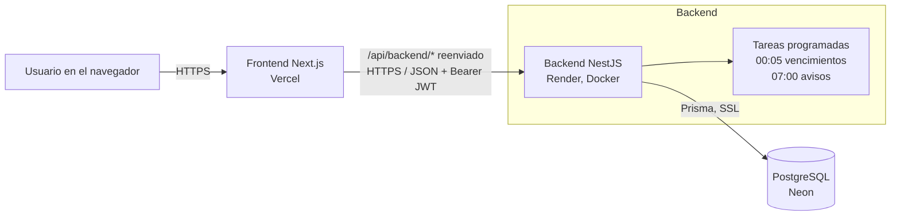
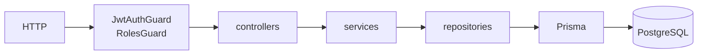

# Arquitectura

## Vista general



El navegador solo habla con el frontend. Next.js reenvía las rutas `/api/backend/*` a la API (rewrite en `next.config.ts`), así que la URL del backend no se expone al navegador. El refresh token vive en una cookie httpOnly que maneja Next.js y el access token se guarda en memoria con Zustand.

### Flujo de una petición en el backend



- `controllers/`: rutas, códigos HTTP y Swagger, sin lógica.
- `services/`: reglas de negocio. No conocen Prisma.
- `repositories/`: todo el acceso a datos. Es el único lugar que usa `PrismaService`.
- Un módulo no usa el repositorio de otro: usa su servicio exportado o un contrato de `src/common/contracts/`.

## Stack

| Capa | Tecnología | Versión |
|---|---|---|
| Frontend | Next.js (App Router) + React, Zustand, Tailwind CSS | Next 16.3, React 19.2, Zustand 5, Tailwind 4 |
| Backend | NestJS + Prisma ORM, @nestjs/swagger, @nestjs/schedule, class-validator, bcrypt, pdfkit | NestJS 12, Prisma 7.10 |
| Base de datos | PostgreSQL | 18 en local (Docker); [versión] en Neon |
| Pruebas | Vitest (unitarias y e2e) | 3.x |
| Contenedores | Docker y docker-compose | Node 24 Alpine |
| Runtime | Node.js | 24 |

## Estructura de carpetas

Backend (`gymhub`):

```
gymhub/
├── prisma/
│   ├── schema/          # un archivo .prisma por módulo
│   ├── migrations/      # migraciones versionadas
│   └── seed.ts          # datos semilla (roles, usuarios y datos de ejemplo)
├── src/
│   ├── auth/            # login, refresh, JWT y guard de roles
│   ├── users/           # miembros, personal y estado de cuentas
│   ├── memberships/     # planes, membresías y tarea de vencimiento
│   ├── classes/         # clases grupales y reservas
│   ├── trainers/        # disponibilidad y sesiones personales
│   ├── check-ins/       # control de acceso
│   ├── payments/        # cobros, pagos, pasarela simulada y comprobantes
│   ├── machines/        # máquinas e historial de estados
│   ├── notifications/   # servicio central de avisos y bandeja
│   ├── routines/        # rutinas, ejercicios y registro de progreso
│   ├── reviews/         # reseñas de clases y sesiones
│   ├── reports/         # ocupación, ingresos, calificaciones y renovación
│   ├── common/          # contratos entre módulos, decoradores y paginación
│   ├── config/          # validación de variables de entorno
│   └── main.ts
├── test/                # pruebas e2e (*.e2e-spec.ts)
├── Dockerfile
└── docker-compose.yml
```

Frontend (`gymhub-frontend`):

```
gymhub-frontend/
├── app/                 # rutas (App Router), un layout por rol
│   ├── admin/  recepcion/  entrenador/  miembro/
│   ├── login/  cambiar-contrasena/
│   └── api/auth/        # route handler del refresh token
├── lib/                 # helpers de servidor (backend, sesión)
├── src/
│   ├── components/      # componentes por rol y compartidos
│   └── services/        # cliente HTTP y servicios por módulo
├── proxy.ts             # redirige a /login las rutas privadas sin sesión
└── next.config.ts       # rewrite /api/backend/* hacia la API
```

## Decisiones técnicas

| Decisión | Alternativas consideradas | Motivo |
|---|---|---|
| Monolito modular en NestJS con un módulo por épica | Microservicios | Un equipo de cinco personas y una sola base de datos; los módulos separan el trabajo sin el costo de operar varios servicios. |
| Capas controller → service → repository | Usar Prisma desde los servicios | Aísla el acceso a datos y facilita las pruebas unitarias de los servicios. |
| Contratos en `src/common/contracts/` entre módulos | Inyectar repositorios de otros módulos | Cada módulo depende de una interfaz y no de la implementación de otro integrante. |
| JWT de acceso de 15 minutos + refresh token de 7 días con rotación | Sesiones en servidor | Viene del boilerplate de la cátedra; la API queda sin estado. |
| Rol en el modelo `User` y `RolesGuard` global con `@Roles` | Tabla de permisos | Cada cuenta tiene un solo rol y el rol se relee de la base en cada petición, así que desactivar o cambiar una cuenta tiene efecto inmediato. |
| Zustand para la sesión en el frontend | Redux, Context | Es liviano y cubre lo global (sesión y contador de avisos) sin configuración extra. |
| Refresh token en cookie httpOnly manejada por Next.js | localStorage | Un script de la página no puede leer el token. |
| Rewrite de Next.js hacia la API | Llamar a la API directo desde el navegador | Mismo origen para el navegador y la URL de la API queda privada. |
| Servicio central de avisos (`notify`) dentro de la transacción del módulo | Que cada módulo escriba sus avisos | Requisito de la épica 9: un solo lugar para los avisos y no quedan avisos de operaciones fallidas. |
| Concurrencia resuelta en la base (índices únicos parciales, `SELECT … FOR UPDATE`, idempotencia en pagos) | Validar solo en el código | Evita sobrecupo en clases, dobles reservas y pagos duplicados aunque lleguen peticiones al mismo tiempo. |
| Pasarela de pago simulada | Pasarela real | El curso no requiere cobros reales; permite probar aprobación y rechazo con tarjetas fijas. |
| Prisma 7 con `engineType = "client"` y adaptador `pg` | Motor nativo de Prisma | La imagen Docker Alpine funciona sin instalar libssl. |
| Despliegue en Vercel, Render y Neon | Railway, Supabase, Netlify | Planes gratuitos; Vercel es nativo para Next.js, Render construye el Dockerfile existente y la base de Neon no vence. |
