# Modelo de datos

El esquema está dividido por módulo en `prisma/schema/` y los cambios se aplican con las migraciones de `prisma/migrations/`. Los usuarios usan UUID; las tablas del dominio usan enteros autoincrementales. El dinero se guarda como `Decimal(8,2)`.

## Diagrama entidad-relación

```mermaid
erDiagram
    USERS ||--o{ REFRESH_TOKENS : "tiene"
    USERS ||--o{ MEMBERSHIPS : "compra (miembro)"
    USERS ||--o{ MEMBERSHIPS : "vende (personal)"
    PLANS ||--o{ MEMBERSHIPS : "define"
    MEMBERSHIPS ||--o| CHARGES : "genera"
    USERS ||--o{ CHARGES : "debe"
    CHARGES ||--o{ PAYMENTS : "intentos"
    CHARGES ||--o| RECEIPTS : "comprobante"
    PAYMENTS ||--o| RECEIPTS : "emite"
    USERS ||--o{ GYM_CLASSES : "imparte (entrenador)"
    GYM_CLASSES ||--o{ CLASS_RESERVATIONS : "tiene"
    USERS ||--o{ CLASS_RESERVATIONS : "reserva (miembro)"
    USERS ||--o{ AVAILABILITY_BLOCKS : "define (entrenador)"
    AVAILABILITY_BLOCKS ||--o{ PERSONAL_SESSIONS : "se agenda en"
    USERS ||--o{ PERSONAL_SESSIONS : "entrenador / miembro"
    USERS ||--o{ CHECK_INS : "ingresa / registra"
    MACHINES ||--o{ MACHINE_STATUS_CHANGES : "historial"
    USERS ||--o{ MACHINE_STATUS_CHANGES : "cambia"
    USERS ||--o{ NOTIFICATIONS : "recibe"
    USERS ||--o{ EXPIRY_NOTICES : "recibe"
    USERS ||--o{ ROUTINES : "asigna / sigue"
    ROUTINES ||--o{ ROUTINE_EXERCISES : "contiene"
    USERS ||--o{ PROGRESS_ENTRIES : "registra"
    USERS ||--o{ REVIEWS : "escribe"
    GYM_CLASSES ||--o{ REVIEWS : "recibe"
    PERSONAL_SESSIONS ||--o{ REVIEWS : "recibe"

    USERS {
        uuid id PK
        string email UK
        string full_name
        enum role "MEMBER, TRAINER, RECEPTION, ADMIN"
        string member_code UK
        bool must_change_password
        bool is_active
    }
    PLANS {
        int id PK
        string name UK
        enum type "MONTHLY, QUARTERLY, DROP_IN"
        int duration_days
        decimal price
        bool is_active
    }
    MEMBERSHIPS {
        int id PK
        uuid member_id FK
        int plan_id FK
        date start_date
        date end_date
        enum status "PENDING_PAYMENT, ACTIVE, EXPIRED"
        bool is_renewal
    }
    CHARGES {
        int id PK
        uuid member_id FK
        int membership_id FK
        enum type "MEMBERSHIP, PERSONAL_SESSION, DROP_IN"
        decimal amount
        date due_date
        enum status "PENDING, PAID"
    }
    PAYMENTS {
        int id PK
        int charge_id FK
        enum method "CASH, CARD"
        enum result "APPROVED, DECLINED"
        string card_last4
        uuid idempotency_key UK
    }
    RECEIPTS {
        int id PK
        string number UK
        int payment_id FK
        int charge_id FK
    }
    GYM_CLASSES {
        int id PK
        uuid trainer_id FK
        string name
        datetime starts_at
        datetime ends_at
        int capacity
        enum status "SCHEDULED, CANCELLED"
    }
    CLASS_RESERVATIONS {
        int id PK
        int class_id FK
        uuid member_id FK
        enum status "CONFIRMED, CANCELLED"
        enum origin "MEMBERSHIP, DROP_IN"
        bool cancelled_by_gym
    }
    AVAILABILITY_BLOCKS {
        uuid id PK
        uuid user_id FK
        int weekday
        string start_time
        string end_time
    }
    PERSONAL_SESSIONS {
        int id PK
        uuid trainer_id FK
        uuid member_id FK
        uuid availability_block_id FK
        datetime starts_at
        int charge_id UK
        enum status
        enum outcome "COMPLETED, NO_SHOW"
    }
    CHECK_INS {
        int id PK
        uuid member_id FK
        uuid registered_by_id FK
        datetime checked_in_at
        string membership_status
        bool is_exception
        string exception_reason
    }
    MACHINES {
        int id PK
        string code UK
        enum area
        enum status "OPERATIONAL, UNDER_MAINTENANCE, OUT_OF_SERVICE"
    }
    MACHINE_STATUS_CHANGES {
        int id PK
        int machine_id FK
        uuid changed_by_id FK
        enum from_status
        enum to_status
        string reason
    }
    NOTIFICATIONS {
        int id PK
        uuid user_id FK
        string title
        string message
        enum source
        datetime read_at
    }
    EXPIRY_NOTICES {
        int id PK
        int membership_id
        uuid member_id FK
        enum kind "D5, D1"
    }
    ROUTINES {
        int id PK
        uuid trainer_id FK
        uuid member_id FK
        string name
        int_array days_of_week
    }
    ROUTINE_EXERCISES {
        int id PK
        int routine_id FK
        int sort_order
        string name
        int sets
        int reps
        decimal suggested_weight_kg
    }
    PROGRESS_ENTRIES {
        int id PK
        uuid member_id FK
        date recorded_at
        decimal weight_kg
        decimal chest_cm
        decimal waist_cm
        decimal arm_cm
    }
    REVIEWS {
        int id PK
        uuid member_id FK
        int gym_class_id FK
        int personal_session_id FK
        int rating
        string comment
    }
```

## Tablas

| Tabla | Descripción | Campos importantes |
|---|---|---|
| `users` | Todas las cuentas del sistema, con su rol y los datos de perfil del miembro. | `email` único, `role`, `member_code`, `must_change_password`, `is_active` |
| `refresh_tokens` | Refresh tokens emitidos, guardados como hash, con rotación y revocación. | `token_hash`, `expires_at`, `revoked_at` |
| `plans` | Tipos de plan que vende el gimnasio (Mensual, Trimestral, Clase suelta). | `type`, `duration_days`, `price`, `is_active` |
| `memberships` | Compra o renovación de una membresía de un miembro. | `start_date`, `end_date`, `status`, `is_renewal`, `created_by_id` |
| `charges` | Cobros pendientes o pagados (membresía, sesión personal, clase suelta). | `type`, `amount`, `due_date`, `status`, `paid_at` |
| `payments` | Cada intento de pago, aprobado o rechazado; solo guarda los últimos 4 dígitos. | `method`, `result`, `decline_reason`, `card_last4`, `idempotency_key` |
| `receipts` | Comprobante con número único de un pago aprobado. | `number`, `payment_id`, `charge_id` |
| `gym_classes` | Clases grupales programadas con su entrenador y cupo. | `starts_at`, `ends_at`, `capacity`, `status`, `cancellation_reason` |
| `class_reservations` | Reservas de cupo; un índice único parcial evita dos reservas confirmadas del mismo miembro en la misma clase. | `status`, `origin`, `cancelled_by_gym` |
| `availability_blocks` | Horarios semanales disponibles de cada entrenador. | `weekday`, `start_time`, `end_time` |
| `personal_sessions` | Sesiones personales de 60 minutos entre entrenador y miembro, con su cobro y resultado. | `starts_at`, `status`, `outcome`, `charge_id` |
| `personal_session_pricing` | Configuración del precio único de la sesión personal (una sola fila). | `price`, `updated_by_id` |
| `check_ins` | Ingresos al gimnasio con una copia del estado de la membresía en ese momento y el motivo si fue excepción. | `checked_in_at`, `membership_status`, `is_exception`, `exception_reason` |
| `machines` | Inventario de máquinas cargado por el seed. | `code`, `area`, `status` |
| `machine_status_changes` | Historial de cambios de estado de una máquina con motivo y autor. | `from_status`, `to_status`, `reason`, `changed_by_id` |
| `notifications` | Avisos dentro de la plataforma, enviados por el servicio central. | `title`, `message`, `source`, `reference_id`, `read_at` |
| `expiry_notices` | Registro de avisos de vencimiento enviados (5 días y 1 día) para no repetirlos. | `membership_id`, `kind`, `end_date` |
| `routines` | Rutina que un entrenador asigna a un miembro, con los días de la semana. | `trainer_id`, `member_id`, `name`, `days_of_week` |
| `routine_exercises` | Ejercicios de una rutina en orden; se borran con la rutina. | `sort_order`, `name`, `sets`, `reps`, `suggested_weight_kg` |
| `progress_entries` | Peso y medidas de un miembro por fecha; una entrada por miembro y día. | `recorded_at`, `weight_kg`, `chest_cm`, `waist_cm`, `arm_cm` |
| `reviews` | Calificación de 1 a 5 estrellas de una clase o una sesión personal, con comentario opcional; un miembro califica cada una una sola vez. | `rating`, `comment`, `gym_class_id`, `personal_session_id` |
