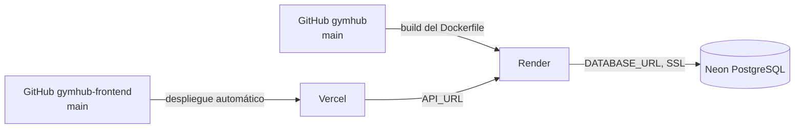

# Despliegue

## Dónde está desplegado

| Componente | Plataforma | URL | Rama |
|---|---|---|---|
| Frontend | Vercel (plan Hobby) | https://gymhub-frontend-gilt.vercel.app/home | main |
| Backend | Render (Web Service con Docker, plan gratuito) | https://gymhub-api-6c9o.onrender.com (Swagger en `/api/docs`) | main |
| Base de datos | Neon (PostgreSQL, plan gratuito) | (privada) | |

## Cómo se publica una nueva versión

1. Con las historias en `develop`, se crea `release/<versión>` desde `develop` en cada repositorio y ahí solo se hacen ajustes finales (número de versión, correcciones menores).
2. Se abre un PR de `release/<versión>` hacia `main`, aprobado por otro integrante, y se fusiona. La misma rama se fusiona también a `develop` para que ambas queden iguales. Las ramas `release/*` están protegidas contra borrado con un ruleset, por eso no las elimina el borrado automático de ramas.
3. Se crea la etiqueta `v<versión>` en GitHub Releases sobre el commit de `main`, con la lista de historias incluidas.
4. Al fusionar a `main`, Vercel y Render despliegan solos. Si la versión trae migraciones nuevas, se aplican antes desde una máquina local con `DATABASE_URL` apuntando a Neon: `npx prisma migrate deploy`.
5. Si cambió el seed, se corre desde una máquina local contra la base de producción, con `DATABASE_URL` apuntando a Neon y las variables `SEED_*` definidas en la terminal: `npm run db:seed` (el plan gratuito de Render no tiene consola).
6. Un defecto en producción se corrige en una rama `hotfix/<descripción>` desde `main`, que se fusiona a `main` y a `develop`, y la versión sube el último número (`v1.0.1`).

### Configuración de cada plataforma

- **Render:** runtime Docker con el `Dockerfile` del repositorio. Comando de arranque: el `CMD` del Dockerfile (`node dist/main.js`); el campo Docker Command de Render queda vacío. Health check: `/api/v1`.
- **Vercel:** framework Next.js, rama de producción `main`. `API_URL` debe existir antes del build, porque el rewrite `/api/backend/*` se arma al compilar.
- **Neon:** una base `neondb`; la cadena de conexión lleva `sslmode=require`.

## Variables de entorno en producción

| Variable | Dónde se configura |
|---|---|
| `NODE_ENV` | Render, Environment |
| `PORT` | Render, Environment |
| `DATABASE_URL` | Render, Environment (cadena de Neon) |
| `JWT_SECRET` | Render, Environment |
| `JWT_EXPIRES_IN` | Render, Environment |
| `REFRESH_TOKEN_EXPIRES_IN_DAYS` | Render y Vercel, Environment Variables |
| `BCRYPT_SALT_ROUNDS` | Render, Environment |
| `FRONTEND_URL` | Render, Environment (origen permitido por CORS) |
| `API_URL` | Vercel, Environment Variables |
| `SEED_ADMIN_PASSWORD`, `SEED_STAFF_PASSWORD`, `SEED_MEMBER_PASSWORD`, `SEED_PERSONAL_SESSION_PRICE` | Solo en la terminal que corre el seed contra Neon; no se guardan en el repositorio |

> El plan gratuito de Render apaga el backend tras unos minutos sin uso y la primera petición tarda en responder. Antes de una revisión, abrir el sistema unos minutos antes.
