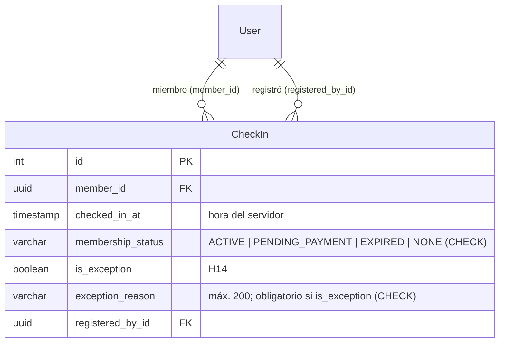

# Épica 4 · Check-in / control de acceso

**H13: Registrar el ingreso de un miembro.** Dueño: Danilo.

## Endpoints

Ambos son solo para **Recepción** y **Administrador** (403 para otro rol, 401
sin sesión).

| Método | Ruta | Task |
|---|---|---|
| GET | `/api/v1/check-ins/lookup?q=GYM-000123` | BE-13.1 |
| POST | `/api/v1/check-ins` | BE-13.1 |

### Búsqueda (`GET /check-ins/lookup`)

`q` de 2 a 100 caracteres (se recorta; fuera de rango responde 400). Busca
miembros activos por **código exacto** o **parte del nombre**, sin distinguir
mayúsculas, y devuelve `{ data[] }` con **máximo 10**, ordenados por nombre.
Cada resultado trae `memberId`, `memberCode`, `fullName`, `membershipStatus`
(`ACTIVE`, `PENDING_PAYMENT`, `EXPIRED` o `NONE`) y `nextPaymentDate`
(`AAAA-MM-DD`, el vencimiento de la membresía actual; `null` sin membresía).

Sin coincidencias, `data` viene vacío: la pantalla muestra "No encontramos
miembros con ese dato." y no permite registrar.

### Registro (`POST /check-ins`)

Cuerpo `{ memberId }`. Responde 201 con `checkInId`, `memberCode`,
`checkedInAt` (hora del servidor), `membershipStatus` e `isException`.

- `checkedInAt` es la hora del servidor; `registeredById` es el usuario
  autenticado. Ninguno viene del cliente.
- `membershipStatus` sale del contrato `MEMBERSHIP_STATUS_SERVICE` (BE-4.3) y se
  guarda como **foto** del momento: si el miembro renueva después, el historial
  no cambia.
- **30 minutos:** si el miembro ya ingresó hace menos de 30 minutos, responde
  409 "Este miembro ya registró su ingreso hace menos de 30 minutos.". La fila
  del miembro se bloquea con `SELECT … FOR UPDATE`, así que dos registros
  simultáneos dejan uno solo.
- 404 "No encontramos ese miembro." si no existe, no es miembro o está
  desactivado; 400 si el id no es un uuid.

La alerta de membresía no vigente y el motivo de excepción son de H14
(BE-14.1); la tabla ya trae `is_exception` y `exception_reason` (DB-13.1).

## Diagrama entidad-relación



Restricciones agregadas a mano en la migración `add_check_ins` (Prisma no las
representa en el schema):

- `check_ins_membership_status_valid`: el estado es uno de los 4 del contrato.
- `check_ins_exception_needs_reason`: una excepción siempre lleva un motivo no
  vacío.

El registro de accesos es permanente: no se borra (`onDelete: Restrict`). La
reversión está en `down.sql`:

```bash
npx prisma db execute --file prisma/migrations/20261119225836_add_check_ins/down.sql
```

## Datos de prueba

El seed carga 10 ingresos de la última semana: 5 de Juan Perez (Activa), 3 de
Luis Martinez (sin membresía) y 2 excepciones de Ana Gomez (Vencida) con su
motivo. Solo se crean si la tabla está vacía.
