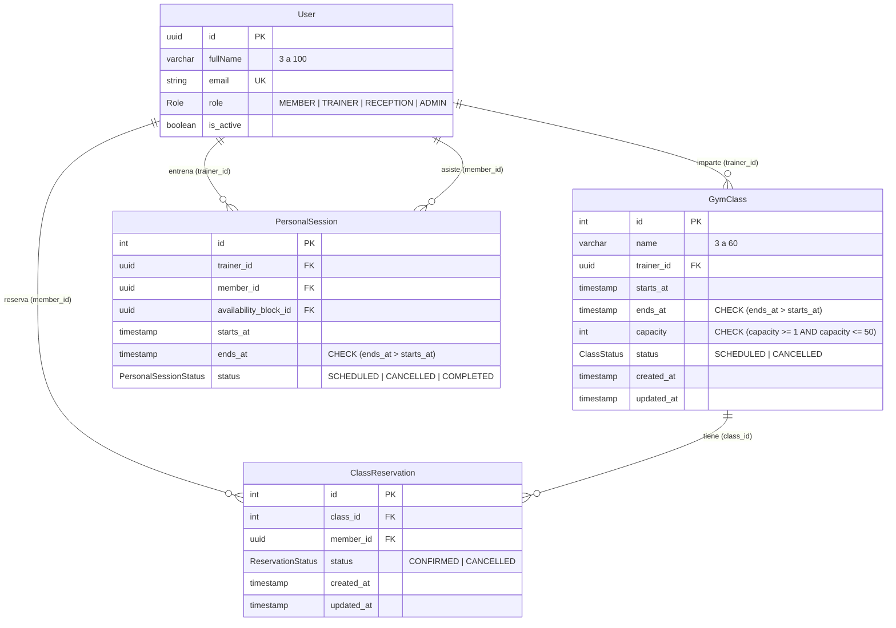
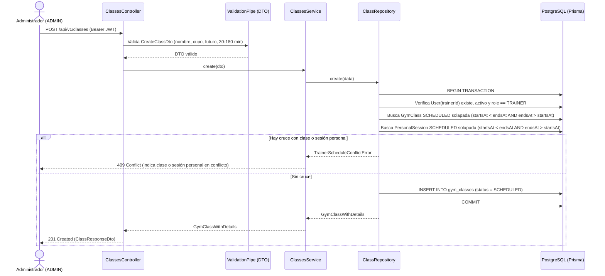

# Épica 2 · Clases grupales

**H06 (SCRUM-21): Programar las clases grupales.** Dueño: Luis Guzmán.

## Endpoints implementados (SCRUM-74 / BE-6.1)

| Método | Ruta | Rol | Subtarea | Descripción |
|---|---|---|---|---|
| `GET` | `/api/v1/classes` | Autenticado (`ADMIN`, `MEMBER`, `TRAINER`, `RECEPTION`) | BE-6.1 / BE-7.1 | Lista las clases del calendario semanal (`from`, `to`) con su cupo y reservas confirmadas |
| `POST` | `/api/v1/classes` | `ADMIN` | BE-6.1 | Programa una nueva clase grupal (`status = SCHEDULED`) |
| `PATCH` | `/api/v1/classes/{classId}` | `ADMIN` | BE-6.1 | Edita nombre, entrenador, horario o cupo de una clase programada |
| `PUT` | `/api/v1/classes/{classId}` | `ADMIN` | BE-6.1 | Alias de edición sobre una clase programada |

---

## Reglas de negocio y estado de cada criterio de H06 en Backend

1. **Control de acceso y rol de entrenador (Criterio 6 — Completo):**
   - Solo un usuario con rol `ADMIN` puede crear o editar clases grupales (`@Roles('ADMIN')` + `RolesGuard`).
   - El usuario asignado en `trainerId` debe existir en `users`, estar activo (`isActive = true`) y tener rol `TRAINER`.
2. **Límites de entrada y aparición en el calendario (Criterios 1 y 4 — Completo):**
   - `name`: cadena recortada (`trim`) de **3 a 60 caracteres**.
   - `capacity`: entero entre **1 y 50** (validado en DTO, servicio y restricción `CHECK ("capacity" >= 1 AND "capacity" <= 50)` en PostgreSQL).
   - `startsAt`: fecha y hora futuras (`startsAt > now`).
   - `endsAt`: posterior a `startsAt` (`CHECK ("ends_at" > "starts_at")` en PostgreSQL) y con una duración entre **30 y 180 minutos**.
   - Al guardar, la clase queda con `status = SCHEDULED` y aparece en el listado del calendario semanal (`GET /api/v1/classes`).
3. **Detección de cruces con clases grupales y sesiones personales (Criterio 5 — Completo):**
   - Dos intervalos `[startsAt, endsAt)` y `[other.startsAt, other.endsAt)` se cruzan sí y solo si `other.startsAt < endsAt` y `other.endsAt > startsAt`.
   - `ClassRepository.assertNoTrainerOverlap` verifica dentro de la misma transacción tanto `gym_classes` (`status = SCHEDULED`) como `personal_sessions` (`status = SCHEDULED`, modelo `PersonalSession` en `prisma/schema/trainers.prisma`).
   - Si hay solapamiento con otra clase o con una sesión personal del mismo entrenador, devuelve **HTTP 409 Conflict** indicando con qué clase o sesión personal hay conflicto.
   - Si una clase termina exactamente cuando empieza otra clase o sesión personal (`endsAt == startsAt`), **NO hay cruce**.
4. **Reducción de cupo y conteo real de reservas confirmadas (Criterios 2 y 3 — Completo):**
   - En una clase `SCHEDULED`, `ClassRepository.update` bloquea la fila con `SELECT … FOR UPDATE` dentro de la transacción y consulta el conteo real en `class_reservations` (`status = 'CONFIRMED'`, modelo `ClassReservation` en `prisma/schema/classes.prisma`) mediante `countConfirmedReservations(classId, tx)`.
   - Si `capacity < confirmedReservations`, rechaza con **HTTP 409 Conflict** sin modificar la clase y con el mensaje exacto:
     `"El cupo no puede ser menor a las 12 reservas confirmadas."`

---

## Diagrama Entidad-Relación (DB-6.1, DB-7.1 y DB-11.1)



---

## Diagrama de Secuencia — Programar y Editar Clase Grupal (BE-6.1)



---

## Contrato HTTP para el Frontend (SCRUM-75 / FE-6.1)

El repositorio actual (`gymhub`) contiene la API backend; a continuación se documenta el contrato completo (calendario semanal, alta y edición) que consume FE-6.1:

### 0. Consultar calendario semanal — `GET /api/v1/classes?from=<ISO>&to=<ISO>`
- **Headers:** `Authorization: Bearer <accessToken>`
- **Response `200 OK`:** Arreglo de `ClassResponseDto` ordenado por `startsAt` ascendente con el conteo real de `confirmedReservations` y `status` (`SCHEDULED` o `CANCELLED`).

### 1. Crear clase grupal — `POST /api/v1/classes`
- **Headers:** `Authorization: Bearer <accessToken>` (rol `ADMIN`)
- **Request Body:**
```json
{
  "name": "Spinning Matutino",
  "trainerId": "3f1c2a9e-7b4d-4c1a-9a6e-1d2b3c4d5e6f",
  "startsAt": "2026-12-01T18:00:00.000Z",
  "endsAt": "2026-12-01T18:50:00.000Z",
  "capacity": 20
}
```
- **Response `201 Created`:**
```json
{
  "id": 1,
  "name": "Spinning Matutino",
  "trainerId": "3f1c2a9e-7b4d-4c1a-9a6e-1d2b3c4d5e6f",
  "trainer": {
    "id": "3f1c2a9e-7b4d-4c1a-9a6e-1d2b3c4d5e6f",
    "fullName": "Entrenador Demo",
    "email": "entrenador@gymhub.test"
  },
  "startsAt": "2026-12-01T18:00:00.000Z",
  "endsAt": "2026-12-01T18:50:00.000Z",
  "capacity": 20,
  "confirmedReservations": 0,
  "status": "SCHEDULED",
  "createdAt": "2026-11-08T20:00:00.000Z",
  "updatedAt": "2026-11-08T20:00:00.000Z"
}
```

### 2. Editar clase grupal — `PATCH /api/v1/classes/:classId`
- **Headers:** `Authorization: Bearer <accessToken>` (rol `ADMIN`)
- **Request Body (campos opcionales):**
```json
{
  "name": "Spinning Avanzado",
  "trainerId": "3f1c2a9e-7b4d-4c1a-9a6e-1d2b3c4d5e6f",
  "startsAt": "2026-12-01T18:00:00.000Z",
  "endsAt": "2026-12-01T19:00:00.000Z",
  "capacity": 15
}
```
- **Response `200 OK`:** Mismo esquema que `ClassResponseDto`.

### 3. Errores de negocio que el formulario FE-6.1 debe mostrar sin cerrarse
| Código | Caso | Ejemplo de `body.message` |
|---|---|---|
| `400 Bad Request` | Validación de nombre, cupo, fecha pasada, duración o rol del entrenador | `"La duración de la clase debe ser de entre 30 y 180 minutos."` |
| `403 Forbidden` | Usuario autenticado sin rol `ADMIN` | `"No tenés permiso para esta acción."` |
| `404 Not Found` | Clase o entrenador inexistente | `"No encontramos esa clase."` |
| `409 Conflict` | Reducción de cupo por debajo de reservas confirmadas reales en BD | `"El cupo no puede ser menor a las 12 reservas confirmadas."` |
| `409 Conflict` | Cruce de horario del entrenador con otra clase grupal o sesión personal | `"El entrenador ya tiene asignada la clase \"Spinning 18:00\" (18:00 a 18:50) que se cruza con ese horario."` o `"El entrenador ya tiene asignada la sesión personal #42 (18:00 a 19:00) que se cruza con ese horario."` |
