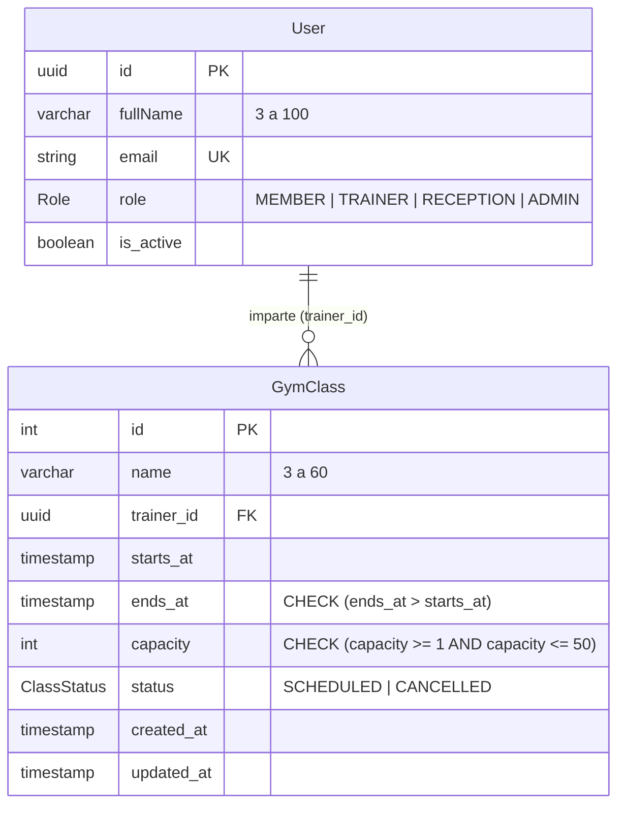
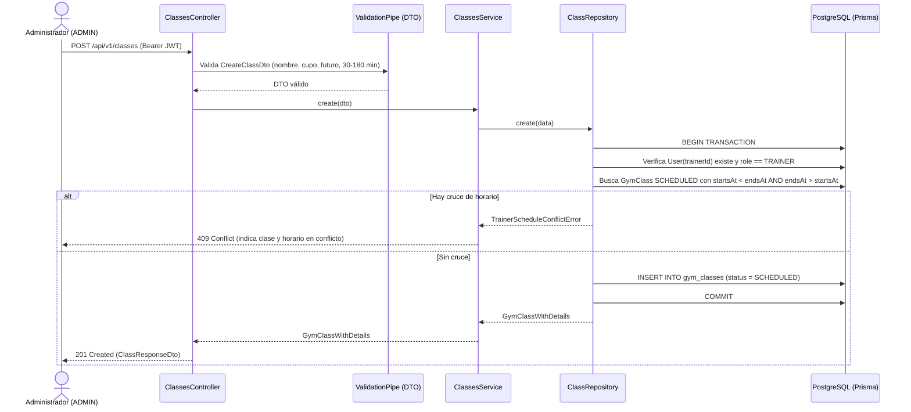

# Épica 2 · Clases grupales

**H06 (SCRUM-21): Programar las clases grupales.** Dueño: Luis Guzmán.

## Endpoints implementados (SCRUM-74 / BE-6.1)

| Método | Ruta | Rol | Subtarea | Descripción |
|---|---|---|---|---|
| `POST` | `/api/v1/classes` | `ADMIN` | BE-6.1 | Programa una nueva clase grupal (`status = SCHEDULED`) |
| `PATCH` | `/api/v1/classes/{classId}` | `ADMIN` | BE-6.1 | Edita nombre, entrenador, horario o cupo de una clase programada |
| `PUT` | `/api/v1/classes/{classId}` | `ADMIN` | BE-6.1 | Alias de edición sobre una clase programada |

---

## Reglas de negocio (H06)

1. **Control de acceso (Criterio 6):**
   - Solo un usuario con rol `ADMIN` puede crear o editar clases grupales (`@Roles('ADMIN')` + `RolesGuard`).
   - El usuario asignado en `trainerId` debe existir en `users`, estar activo (`isActive = true`) y tener rol `TRAINER`.
2. **Límites de entrada (Criterios 1 y 4):**
   - `name`: cadena recortada (`trim`) de **3 a 60 caracteres**.
   - `capacity`: entero entre **1 y 50** (validado en DTO, servicio y restricción `CHECK ("capacity" >= 1 AND "capacity" <= 50)` en PostgreSQL).
   - `startsAt`: fecha y hora futuras (`startsAt > now`).
   - `endsAt`: posterior a `startsAt` (`CHECK ("ends_at" > "starts_at")` en PostgreSQL) y con una duración entre **30 y 180 minutos**.
3. **Detección de cruces y horarios contiguos (Criterio 5):**
   - Dos intervalos `[startsAt, endsAt)` y `[other.startsAt, other.endsAt)` se cruzan sí y solo si `other.startsAt < endsAt` y `other.endsAt > startsAt`.
   - Una clase de `18:00` a `18:50` se cruza con otra del mismo entrenador que inicia a las `18:30` y devuelve **HTTP 409 Conflict** indicando el nombre y horario de la clase en conflicto.
   - Si una clase termina exactamente cuando empieza otra (`18:00` y `18:00`), **NO hay cruce**.
4. **Reducción de cupo (Criterios 2 y 3):**
   - En una clase `SCHEDULED`, se bloquea la fila con `SELECT … FOR UPDATE` dentro de la transacción y se compara el nuevo `capacity` con las reservas confirmadas (`confirmedReservations`).
   - Si `capacity < confirmedReservations` (por ejemplo, bajar de 20 a 10 con 12 reservas confirmadas), se rechaza con **HTTP 409 Conflict** sin modificar la clase y con el mensaje exacto:
     `"El cupo no puede ser menor a las 12 reservas confirmadas."`

---

## Diagrama Entidad-Relación (SCRUM-73 / DB-6.1)



---

## Diagrama de Secuencia — Programar y Editar Clase Grupal (BE-6.1)



---

## Contrato HTTP para el Frontend (SCRUM-75 / FE-6.1)

El repositorio actual (`gymhub`) contiene únicamente el backend API; el proyecto frontend no se encuentra en este repositorio y además están pendientes **BE-7.1** (listado semanal de clases con cupos de H07) y **FE-2.2** (protección de rutas y menú por rol en el cliente). A continuación se documenta el contrato que consumirá FE-6.1:

### 1. Crear clase grupal — `POST /api/v1/classes`
- **Headers:** `Authorization: Bearer <accessToken>` (rol `ADMIN`)
- **Request Body:**
```json
{
  "name": "Spinning Matutino",
  "trainerId": "3f1c2a9e-7b4d-4c1a-9a6e-1d2b3c4d5e6f",
  "startsAt": "2026-12-01T18:00:00.000Z",
  "endsAt": "2026-12-01T18:50:00.000Z",
  "capacity": 20
}
```
- **Response `201 Created`:**
```json
{
  "id": 1,
  "name": "Spinning Matutino",
  "trainerId": "3f1c2a9e-7b4d-4c1a-9a6e-1d2b3c4d5e6f",
  "trainer": {
    "id": "3f1c2a9e-7b4d-4c1a-9a6e-1d2b3c4d5e6f",
    "fullName": "Entrenador Demo",
    "email": "entrenador@gymhub.test"
  },
  "startsAt": "2026-12-01T18:00:00.000Z",
  "endsAt": "2026-12-01T18:50:00.000Z",
  "capacity": 20,
  "confirmedReservations": 0,
  "status": "SCHEDULED",
  "createdAt": "2026-11-08T20:00:00.000Z",
  "updatedAt": "2026-11-08T20:00:00.000Z"
}
```

### 2. Editar clase grupal — `PATCH /api/v1/classes/:classId`
- **Headers:** `Authorization: Bearer <accessToken>` (rol `ADMIN`)
- **Request Body (campos opcionales):**
```json
{
  "name": "Spinning Avanzado",
  "trainerId": "3f1c2a9e-7b4d-4c1a-9a6e-1d2b3c4d5e6f",
  "startsAt": "2026-12-01T18:00:00.000Z",
  "endsAt": "2026-12-01T19:00:00.000Z",
  "capacity": 15
}
```
- **Response `200 OK`:** Mismo esquema que `ClassResponseDto`.

### 3. Errores de negocio que el formulario FE-6.1 debe mostrar sin cerrarse
| Código | Caso | Ejemplo de `body.message` |
|---|---|---|
| `400 Bad Request` | Validación de nombre, cupo, fecha pasada, duración o rol del entrenador | `"La duración de la clase debe ser de entre 30 y 180 minutos."` |
| `403 Forbidden` | Usuario autenticado sin rol `ADMIN` | `"No tenés permiso para esta acción."` |
| `404 Not Found` | Clase o entrenador inexistente | `"No encontramos esa clase."` |
| `409 Conflict` | Reducción de cupo por debajo de reservas confirmadas | `"El cupo no puede ser menor a las 12 reservas confirmadas."` |
| `409 Conflict` | Cruce de horario del entrenador con otra clase o sesión | `"El entrenador ya tiene asignada la clase \"Spinning 18:00\" (18:00 a 18:50) que se cruza con ese horario."` |

---

## Bloqueos y dependencias pendientes de otras historias

1. **Conteo real de reservas confirmadas en BD (`DB-7.1 / H07`):**
   - `ClassRepository.countConfirmedReservations(classId, tx)` está preparado e integrado en el flujo transaccional de edición (`SELECT ... FOR UPDATE`), pero devuelve `0` hasta que **DB-7.1 (H07)** agregue la tabla de reservas de clases (`ClassReservation`) en `prisma/schema/classes.prisma`.
2. **Validación de cruce contra sesiones personales (`DB-11.1 / H11`):**
   - `TrainerScheduleConflictError` ya soporta conflictos de tipo `PERSONAL_SESSION`, pero la consulta en base de datos dentro de `ClassRepository.assertNoTrainerOverlap` depende de que **DB-11.1 (H11)** agregue el modelo `PersonalSession` en `prisma/schema/trainers.prisma`.
3. **Interfaz de administración (`SCRUM-75 / FE-6.1`):**
   - Bloqueada porque el repositorio del frontend no está presente en este workspace y además depende de **BE-7.1** (endpoint de calendario semanal de H07) y **FE-2.2** (protección de rutas/menú por rol).
4. **Pruebas de QA en ambiente desplegado (`SCRUM-76 / QA-6.1`):**
   - Corresponden a Juan Carlos una vez estén integrados DB-6.1, BE-6.1 y FE-6.1 en el ambiente desplegado.
