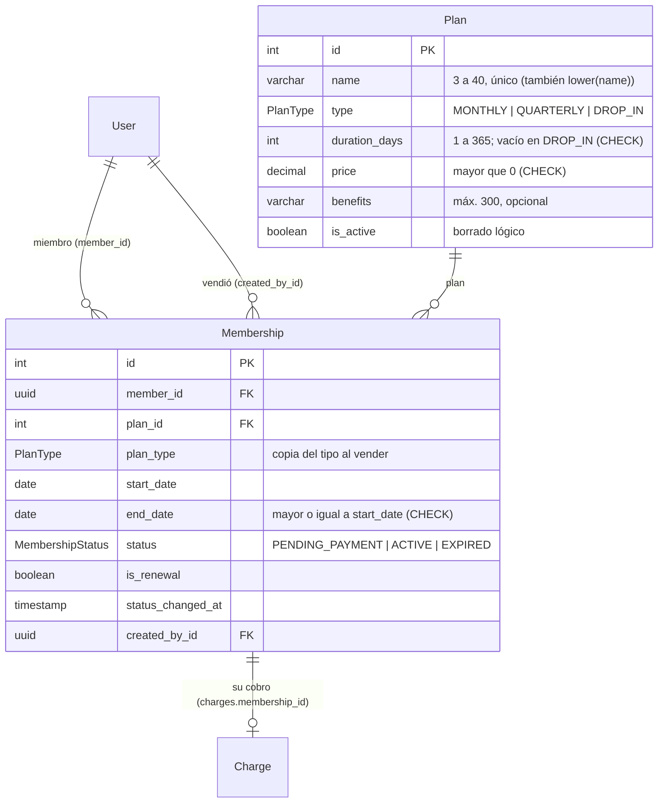

# Épica 1 · Membresías y planes

**H03: Definir los tipos de plan.** Dueño: Danilo.
**H04: Registrar la compra o renovación de una membresía.** Dueño: Danilo.
**H05: Consultar el estado de mi membresía.** Dueño: Juan Carlos.

## Endpoints

| Método | Ruta | Rol | Task |
|---|---|---|---|
| GET | `/api/v1/plans?active=true` | Cualquier usuario con sesión | BE-3.1 |
| POST | `/api/v1/plans` | Administrador | BE-3.1 |
| PATCH | `/api/v1/plans/{planId}` | Administrador | BE-3.1 |
| PATCH | `/api/v1/plans/{planId}/deactivate` | Administrador | BE-3.1 |
| POST | `/api/v1/memberships` | Recepción, Administrador | BE-4.1 |
| POST | `/api/v1/memberships/drop-in` | Recepción, Administrador | BE-4.2 |
| GET | `/api/v1/members?q=` (módulo de usuarios) | Recepción, Administrador | FE-4.1 |
| GET | `/api/v1/memberships/me` | Miembro | BE-5.1 |

## Planes (H03)

`GET /plans` devuelve `{ data[] }` ordenado por nombre, sin paginar (son pocos).
Con `?active=true` trae solo los planes que se pueden vender; sin el filtro,
todos, incluidos los desactivados. Cada plan trae `id`, `name`, `type`,
`durationDays`, `price` (número con 2 decimales), `benefits` e `isActive`.

| Campo | Regla |
|---|---|
| `name` | 3 a 40 caracteres, se recorta; único sin distinguir mayúsculas |
| `type` | `MONTHLY`, `QUARTERLY` o `DROP_IN`; no se puede cambiar después |
| `durationDays` | Entero de 1 a 365; obligatorio salvo en `DROP_IN`, que no lo acepta |
| `price` | Mayor que 0, con 2 decimales como máximo |
| `benefits` | Opcional, máx. 300 caracteres; vacío o `null` lo borra |

Errores: 400 dato inválido, `type` enviado en el PATCH o duración en un
`DROP_IN` ("La clase suelta no lleva duración."); 401 sin sesión; 403 si no es
Administrador; 404 "No encontramos ese plan."; 409 "Ya existe un plan con ese
nombre." o "Ya existe un plan de clase suelta activo.".

- **Desactivar** solo cambia `isActive`: el plan deja de ofrecerse en la venta,
  pero las membresías ya vendidas con él no se tocan. Desactivar uno inactivo
  no cambia nada.
- **Unicidad en la base.** El servicio revisa las reglas antes de escribir para
  responder con el motivo exacto, y la base las garantiza: si dos altas llegan a
  la vez, la que pierde choca con el índice único y responde 409. El repositorio
  distingue el índice que falló por
  `meta.driverAdapterError.cause.constraint.index`.

## Venta de membresías (H04 · BE-4.1)

`POST /memberships` con `memberId` (uuid de un miembro activo), `planId` (plan
activo `MONTHLY` o `QUARTERLY`) y `startDate` opcional (`AAAA-MM-DD`, hoy o
posterior; por defecto hoy). Responde 201 con `id`, `plan`, `planType`,
`startDate`, `endDate`, `status` (`PENDING_PAYMENT`), `isRenewal`, `chargeId` y
`amount`.

- `endDate = startDate + durationDays − 1`, el último día con acceso: un plan de
  30 días desde el 2026-11-10 vence el 2026-12-09.
- **Renovación sin perder días:** si el miembro tiene una membresía pagada que
  no ha vencido, la nueva inicia el día siguiente a su vencimiento (se ignora
  `startDate`).
- `isRenewal` es true si el miembro ya tuvo antes una `MONTHLY` o `QUARTERLY`.
- **Una transacción:** la membresía y su cobro `PENDING` (contrato
  `CHARGES_SERVICE` de Pagos, tipo `MEMBERSHIP`, monto = precio del plan,
  vencimiento = `startDate`) se crean juntos. La fila del miembro se bloquea con
  `SELECT … FOR UPDATE`: dos ventas simultáneas al mismo miembro se atienden de
  una en una.
- **Supuesto del equipo:** si el miembro ya tiene una membresía sin pagar que no
  ha vencido, responde 409 "El miembro ya tiene una membresía pendiente de
  pago.", para no generar dos cobros por el mismo periodo.

Errores: 400 plan desactivado, plan de clase suelta, fecha de inicio anterior a
hoy o datos inválidos; 401; 403 si no es Recepción ni Administrador; 404 "No
encontramos ese miembro." (no existe, no es miembro o está desactivado) o "No
encontramos ese plan."; 409 el de arriba.

Para elegir al miembro, `GET /members?q=` busca miembros activos por código
exacto o parte del nombre, sin distinguir mayúsculas: máximo 10, ordenados por
nombre, con `id`, `memberCode`, `fullName` y `email`. Responde 400 con menos de
2 o más de 100 caracteres.

## Venta de clase suelta (H04 · BE-4.2)

`POST /memberships/drop-in` (Recepción, Administrador) con `memberId`,
`classId` (clase de hoy que todavía no inicia), `paymentMethod` (`CASH` o
`CARD`), `card` (obligatoria con `CARD`, reglas de la pasarela simulada) e
`idempotencyKey` (uuid por intento). Responde 201 con `membershipId`,
`reservationId`, `receiptNumber`, `amount`, `endDate` (hoy), `className` y
`classStartsAt`.

Todo en **una transacción** (15 s, porque la pasarela simula 2 s con la clase
bloqueada):

1. Bloquea al miembro y verifica que sea un miembro activo.
2. Reserva con `ClassReservationRepository.reserveInTransaction` (Clases):
   bloquea la clase con `SELECT … FOR UPDATE`, valida cupo y estado, y crea la
   reserva con origen `DROP_IN`. Una reserva en línea por el último cupo espera
   el mismo bloqueo: solo una de las dos lo obtiene y la otra recibe 409.
3. Crea la membresía `ACTIVE` con `planType` `DROP_IN`, que inicia y vence hoy.
4. Crea el cobro `DROP_IN` (monto = precio del plan `DROP_IN` activo, leído en el
   servidor) y lo paga con el contrato `PAYMENTS_SERVICE` de Pagos (efectivo, o
   tarjeta por la pasarela), que emite el comprobante y deja el cobro `PAID`.

Si la pasarela rechaza o falta cupo, **no se guarda nada**: ni membresía, ni
reserva, ni cobro, ni el intento de pago.

Errores: 400 datos inválidos, tarjeta sin datos, sin plan de clase suelta activo
o tarjeta rechazada (con el motivo en `message` y `declineReason`); 401; 403;
404 "No encontramos ese miembro." o "No encontramos esa clase."; 409 "La clase
está llena.", "La clase está cancelada.", "La clase ya inició.", "La clase
suelta solo se vende para una clase de hoy." o "El miembro ya tiene una reserva
en esa clase.".

La clase suelta no se puede cancelar ni reembolsar (H08 la rechaza por su origen
`DROP_IN`). En "Mi membresía" (H05) aparece con la clase incluida.

## Estado de la membresía (H04 · BE-4.3)

El estado **se calcula al leer** en `computeCurrentMembership`
(`services/membership-status.ts`); es la única regla de todo el sistema.

| Estado | Cuándo |
|---|---|
| `ACTIVE` | Tiene una membresía con el cobro pagado y hoy ≤ `endDate`. Si hay varias (la actual y su renovación pagada), se muestra la que inicia primero. |
| `PENDING_PAYMENT` | Sin activa, la más reciente sin pagar que no ha vencido. |
| `EXPIRED` | Tuvo membresías y todas vencieron (la de `endDate` más reciente). |
| `NONE` | Nunca ha tenido una. |

"Hoy" es la fecha del gimnasio (`America/El_Salvador`), no `CURRENT_DATE` de
Postgres. En el contrato, `endDate` viaja como el último instante de ese día en
El Salvador: quien lo formatee en la zona del gimnasio (como H05) ve el mismo
día. `daysLeft` son los días hasta el vencimiento, o `null` si ya venció.

**Tarea diaria** (`MembershipExpiryJob`, `@Cron('5 0 * * *')` en
`America/El_Salvador`): sincroniza el valor guardado en `memberships.status`
con `statusChangedAt`. Pasa a `ACTIVE` las pendientes cuyo cobro ya se pagó
(Pagos no toca esta tabla) y a `EXPIRED` las activas con `endDate` anterior a
hoy. Si corre dos veces el mismo día, la segunda no cambia nada. Las pantallas
no dependen de ella: el estado se calcula al leer.

### Contratos que registra este módulo

| Token | Lo consumen | Qué entrega |
|---|---|---|
| `MEMBERSHIP_STATUS_SERVICE` | Reservas (H07), Mi membresía (H05), pago en línea (H16), check-in (H13) | `currentFor(memberId)`: estado, plan, vencimiento y días restantes |
| `MEMBERSHIP_EXPIRY_SOURCE` | Avisos de vencimiento (H26) | `expiringOn(fecha)`: membresías pagadas que vencen ese día y si ya se registró la siguiente |

Los consumidores los buscan con `ModuleRef` (`strict: false`), sin importar
este módulo. En pruebas, para usar uno falso, reemplazarlo con
`overrideProvider(MEMBERSHIP_STATUS_SERVICE)`: un módulo global con el mismo
token no garantiza cuál de los dos encuentra `ModuleRef`.

## Diagrama entidad-relación



Restricciones agregadas a mano (Prisma no las representa en el schema):

- `add_plans`: `plans_price_positive` (`price > 0`); `plans_duration_by_type`
  (`DROP_IN` sin duración, los demás con duración **no nula** de 1 a 365: sin el
  `IS NOT NULL`, un `NULL` pasaría el CHECK); `plans_name_lower_key` (único
  sobre `lower(name)`); `plans_single_active_drop_in_key` (único parcial, un solo
  `DROP_IN` activo).
- `add_memberships`: `memberships_end_not_before_start`
  (`end_date >= start_date`). Agrega además la llave foránea
  `charges.membership_id → memberships.id` que Pagos dejó pendiente para H04.

Las membresías no se borran: el historial es permanente (`onDelete: Restrict`).
`expiry_notices.membership_id` (H26) todavía no tiene llave foránea, porque su
e2e usa ids de prueba que no existen en `memberships`.

Cada migración trae su reversión en `down.sql`:

```bash
npx prisma db execute --file prisma/migrations/20261119170532_add_memberships/down.sql
npx prisma db execute --file prisma/migrations/20261119054011_add_plans/down.sql
```

## Datos de prueba

- **Planes:** con `upsert` por nombre, Mensual de 30 días a $25.00, Trimestral
  de 90 días a $65.00 y Clase suelta a $5.00. `update: {}` no pisa un plan que
  el administrador ya editó o desactivó.
- **Membresías:** una por estado, cada una con su cobro (y su pago y
  comprobante si está pagada): Juan Perez con una Mensual Activa, Ana Gomez con
  una Mensual Vencida y Luis Martinez con una Trimestral Pendiente de pago. Solo
  se crean si el miembro no tiene membresías, así que correr el seed dos veces
  no las duplica.

## Mi membresía (H05)

`GET /memberships/me` responde con el contrato `MEMBERSHIP_STATUS_SERVICE` de
este módulo. El 503 de `MyMembershipService` solo se da si el contrato no está
registrado, cosa que ya no pasa con `AppModule`.
