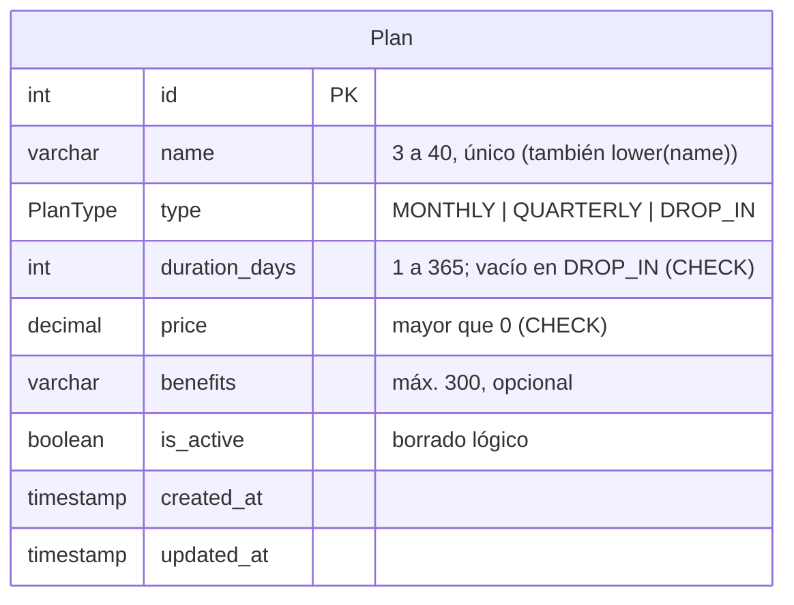

# Épica 1 · Membresías y planes

**H03: Definir los tipos de plan.** Dueño: Danilo.
**H05: Consultar el estado de mi membresía.** Dueño: Juan Carlos.

## Endpoints

| Método | Ruta | Rol | Task |
|---|---|---|---|
| GET | `/api/v1/plans?active=true` | Cualquier usuario con sesión | BE-3.1 |
| POST | `/api/v1/plans` | Administrador | BE-3.1 |
| PATCH | `/api/v1/plans/{planId}` | Administrador | BE-3.1 |
| PATCH | `/api/v1/plans/{planId}/deactivate` | Administrador | BE-3.1 |
| GET | `/api/v1/memberships/me` | Miembro | BE-5.1 |

## Planes (H03)

`GET /plans` devuelve `{ data[] }` ordenado por nombre, sin paginar (son pocos).
Con `?active=true` trae solo los planes que se pueden vender; sin el filtro,
todos, incluidos los desactivados. Cada plan trae `id`, `name`, `type`,
`durationDays`, `price` (número con 2 decimales), `benefits` e `isActive`.

| Campo | Regla |
|---|---|
| `name` | 3 a 40 caracteres, se recorta; único sin distinguir mayúsculas |
| `type` | `MONTHLY`, `QUARTERLY` o `DROP_IN`; no se puede cambiar después |
| `durationDays` | Entero de 1 a 365; obligatorio salvo en `DROP_IN`, que no lo acepta |
| `price` | Mayor que 0, con 2 decimales como máximo |
| `benefits` | Opcional, máx. 300 caracteres; vacío o `null` lo borra |

Errores: 400 dato inválido, `type` enviado en el PATCH o duración en un
`DROP_IN` ("La clase suelta no lleva duración."); 401 sin sesión; 403 si no es
Administrador; 404 "No encontramos ese plan."; 409 "Ya existe un plan con ese
nombre." o "Ya existe un plan de clase suelta activo.".

- **Desactivar** solo cambia `isActive`: el plan deja de ofrecerse en la venta,
  pero las membresías ya vendidas con él no se tocan. Desactivar uno inactivo
  no cambia nada.
- **Unicidad en la base.** El servicio revisa las reglas antes de escribir para
  responder con el motivo exacto, y la base las garantiza: si dos altas llegan a
  la vez, la que pierde choca con el índice único y responde 409. El repositorio
  distingue el índice que falló por
  `meta.driverAdapterError.cause.constraint.index`.

## Diagrama entidad-relación



Restricciones agregadas a mano en la migración `add_plans` (Prisma no las
representa en el schema):

- `plans_price_positive`: `price > 0`.
- `plans_duration_by_type`: `DROP_IN` sin duración; los demás con duración
  **no nula** de 1 a 365 (sin el `IS NOT NULL`, un `NULL` pasaría el CHECK).
- `plans_name_lower_key`: índice único sobre `lower(name)`.
- `plans_single_active_drop_in_key`: índice único parcial, un solo `DROP_IN`
  activo; los desactivados no cuentan.

La reversión está en `down.sql` de la migración:

```bash
npx prisma db execute --file prisma/migrations/20261119054011_add_plans/down.sql
```

## Datos de prueba

El seed carga con `upsert` por nombre (correrlo dos veces no duplica) los planes
Mensual de 30 días a $25.00, Trimestral de 90 días a $65.00 y Clase suelta a
$5.00. `update: {}` no pisa un plan que el administrador ya editó o desactivó.

## Mi membresía (H05)

`GET /memberships/me` responde con el contrato `MEMBERSHIP_STATUS_SERVICE`, que
registra H04 en este módulo. Mientras no exista, responde 503.
