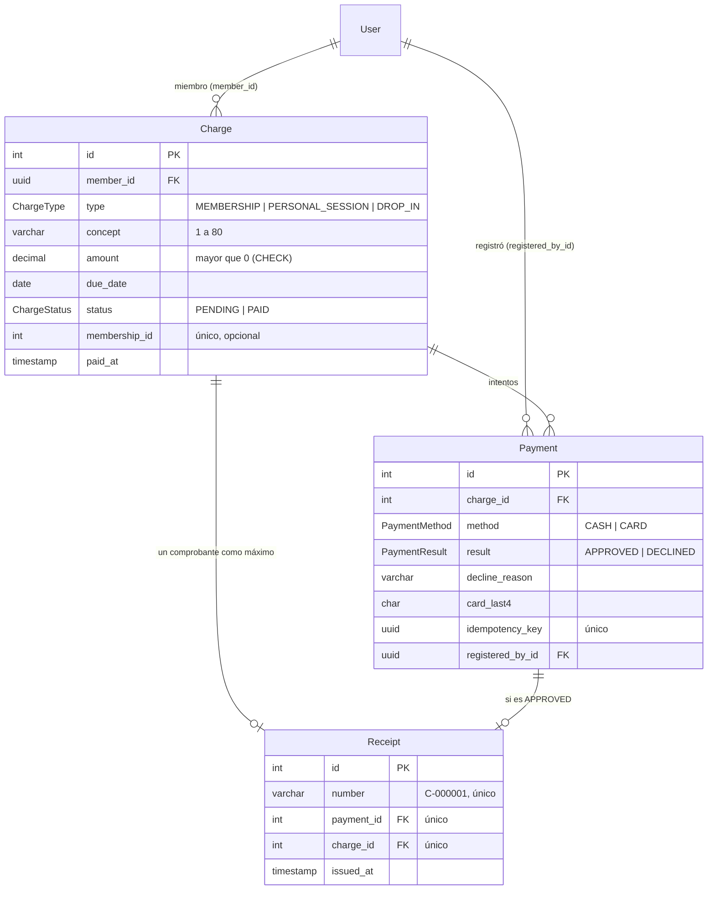

# Épica 5 · Pagos y facturación

**H15 (SCRUM-30): Registrar un pago en recepción.** Dueño: Jaime.

## Endpoints

| Método | Ruta | Rol | Task |
|---|---|---|---|
| GET | `/api/v1/members/{memberId}/charges?status=PENDING` | Recepción, Administrador | BE-15.1 |
| GET | `/api/v1/charges/member-search?q=` | Recepción, Administrador | FE-15.1 |
| POST | `/api/v1/payments` | Recepción, Administrador | BE-15.2 |
| GET | `/api/v1/receipts/{receiptId}/pdf` | Recepción, Administrador o el Miembro dueño | BE-15.4 |

## Contrato para otros módulos: `CHARGES_SERVICE`

H04 (membresías) y H11 (sesiones personales) crean cobros solo a través de este
contrato, dentro de **su propia transacción**. Ningún otro módulo inserta en
`charges` directamente.

```ts
// En tu módulo: imports: [PaymentsModule]
constructor(@Inject(CHARGES_SERVICE) private readonly charges: ChargesService) {}

await this.prisma.$transaction(async (tx) => {
  const membership = await tx.membership.create({ ... });
  await this.charges.createPending(
    { memberId, type: 'MEMBERSHIP', concept: 'Membresía Mensual', amount: 25, dueDate, membershipId: membership.id },
    tx,
  );
});
```

Si la transacción de quien llama se revierte, el cobro tampoco queda. Un monto
de 0 o negativo lanza `InvalidChargeError`.

## Pasarela de pago simulada (BE-15.3)

`PaymentGatewayService.charge(tarjeta, monto)` valida los datos, espera 2
segundos y devuelve `{ result, declineReason, cardLast4 }`. Se exporta para H04
(clase suelta) y H16 (pago en línea).

| Tarjeta | Resultado |
|---|---|
| `4242 4242 4242 4242` | APPROVED |
| `4000 0000 0000 0002` | DECLINED, "Fondos insuficientes" |
| Cualquier otro número | DECLINED, "Tarjeta no válida para pruebas" |
| Vencimiento anterior al mes actual | DECLINED, "Tarjeta vencida" |

Pide número de 16 dígitos, titular de 3 a 60 caracteres, vencimiento MM/AA y
CVV de 3 dígitos. **Nunca** guarda ni escribe en logs el número completo ni el
CVV: solo se guardan los últimos 4 dígitos.

## Reglas del pago (POST /payments)

- El monto se toma del cobro guardado; la solicitud no lo trae.
- El cobro se bloquea con `SELECT … FOR UPDATE` durante toda la transacción.
- La misma `idempotencyKey` devuelve el resultado original sin cobrar dos veces.
- Un pago rechazado se guarda con su motivo y el cobro sigue `PENDING` (400).
- Pagar un cobro `PAID` responde 409 "Este cobro ya está pagado."
- Cobros, pagos y comprobantes nunca se borran.

## Diagrama entidad-relación



`receipts.charge_id` es único: la base rechaza un segundo comprobante (y por lo
tanto un segundo pago aprobado) del mismo cobro. El número sale de la secuencia
del id de `receipts` (el comprobante 7 es `C-000007`).

## Pendiente por dependencias

- **H04:** cuando exista `Membership`, agregar la relación `Charge.membership`.
  Según el contrato `membership-status`, la membresía queda activa en cuanto su
  cobro está `PAID`.
- **H01:** buscar y mostrar por `fullName` y `memberCode` en lugar del correo.
