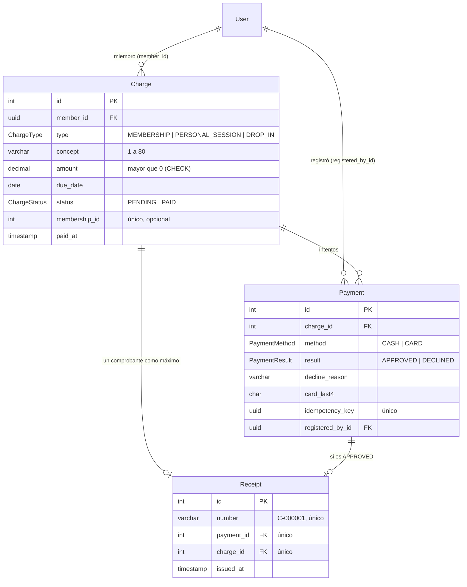

# Épica 5 · Pagos y facturación

**H15 (SCRUM-30): Registrar un pago en recepción.** Dueño: Jaime.
**H16 (SCRUM-31): Pagar con tarjeta mi membresía o sesión personal.** Dueño: Jaime.
**H17 (SCRUM-32): Consultar los pagos pendientes.** Dueño: Jaime.

## Endpoints

| Método | Ruta | Rol | Task |
|---|---|---|---|
| GET | `/api/v1/members/{memberId}/charges?status=PENDING` | Recepción, Administrador | BE-15.1 |
| GET | `/api/v1/charges/member-search?q=` | Recepción, Administrador | FE-15.1 |
| POST | `/api/v1/payments` | Recepción, Administrador | BE-15.2 |
| GET | `/api/v1/receipts/{receiptId}/pdf` | Recepción, Administrador o el Miembro dueño | BE-15.4 |
| GET | `/api/v1/charges/me?status=PENDING` | Miembro | BE-16.1 |
| GET | `/api/v1/receipts/me?page=1` | Miembro | BE-16.1 |
| POST | `/api/v1/charges/{chargeId}/card-payment` | Miembro | BE-16.2 |
| GET | `/api/v1/charges/pending?type=MEMBERSHIP&page=1` | Administrador | BE-17.1 |

## Contrato para otros módulos: `CHARGES_SERVICE`

H04 (membresías) y H11 (sesiones personales) crean cobros solo a través de este
contrato, dentro de **su propia transacción**. Ningún otro módulo inserta en
`charges` directamente.

```ts
// En tu módulo: imports: [PaymentsModule]
constructor(@Inject(CHARGES_SERVICE) private readonly charges: ChargesService) {}

await this.prisma.$transaction(async (tx) => {
  const membership = await tx.membership.create({ ... });
  await this.charges.createPending(
    { memberId, type: 'MEMBERSHIP', concept: 'Membresía Mensual', amount: 25, dueDate, membershipId: membership.id },
    tx,
  );
});
```

Si la transacción de quien llama se revierte, el cobro tampoco queda. Un monto
de 0 o negativo lanza `InvalidChargeError`.

## Contrato para otros módulos: `PAYMENTS_SERVICE`

Paga un cobro **dentro de la transacción de quien llama**, con las mismas reglas
que `POST /payments`: bloquea el cobro, toma el monto del cobro guardado, pasa la
tarjeta por la pasarela, emite el comprobante y deja el cobro `PAID`. Lo agregó
H04 para la clase suelta, donde el cupo, la membresía, la reserva, el cobro y el
pago se guardan juntos o no se guarda nada.

```ts
const result = await this.payments.payInTransaction(
  { chargeId, method: 'CARD', card, idempotencyKey, registeredById },
  tx,
);
// { kind: 'APPROVED', receiptId, receiptNumber, amount }
// | { kind: 'DECLINED', declineReason }
```

Una tarjeta rechazada o con datos no válidos vuelve como `DECLINED` con el
motivo; quien llama decide si revierte su transacción (y con ella el intento).
Reutiliza `PaymentRepository.payInTransaction`, la misma lógica de `pay`.

## Pasarela de pago simulada (BE-15.3)

`PaymentGatewayService.charge(tarjeta, monto)` valida los datos, espera 2
segundos y devuelve `{ result, declineReason, cardLast4 }`. Se exporta para H04
(clase suelta) y H16 (pago en línea).

| Tarjeta | Resultado |
|---|---|
| `4242 4242 4242 4242` | APPROVED |
| `4000 0000 0000 0002` | DECLINED, "Fondos insuficientes" |
| Cualquier otro número | DECLINED, "Tarjeta no válida para pruebas" |
| Vencimiento anterior al mes actual | DECLINED, "Tarjeta vencida" |

Pide número de 16 dígitos, titular de 3 a 60 caracteres, vencimiento MM/AA y
CVV de 3 dígitos. **Nunca** guarda ni escribe en logs el número completo ni el
CVV: solo se guardan los últimos 4 dígitos.

## Reglas del pago (POST /payments)

- El monto se toma del cobro guardado; la solicitud no lo trae.
- El cobro se bloquea con `SELECT … FOR UPDATE` durante toda la transacción.
- La misma `idempotencyKey` devuelve el resultado original sin cobrar dos veces.
- Un pago rechazado se guarda con su motivo y el cobro sigue `PENDING` (400).
- Pagar un cobro `PAID` responde 409 "Este cobro ya está pagado."
- Cobros, pagos y comprobantes nunca se borran.

## Pago en línea del miembro (H16)

- El miembro siempre sale del token: ninguna ruta recibe el id de otro miembro.
- `POST /charges/{chargeId}/card-payment` usa la **misma transacción** que
  H15 (`PaymentRepository.pay`) con `ownerId`: después del `FOR UPDATE`, si el
  cobro es de otro miembro responde 404 "No encontramos ese cobro.", igual que
  si no existiera. La revisión del dueño va **antes** de mirar la clave de
  idempotencia, para que una clave ajena no revele nada.
- Mismas reglas que H15: el monto sale del cobro, la misma clave devuelve el
  resultado original, rechazo = 400 con el motivo, ya pagado = 409. Dos
  solicitudes con claves distintas sobre el mismo cobro dejan un solo pago
  APPROVED.
- El pago queda registrado por el propio miembro (`registered_by_id`).
- `membershipStatus`: solo en cobros de membresía. Lo calcula H04 con el
  contrato `MEMBERSHIP_STATUS_SERVICE`; `MembershipStatusLookup` lo busca con
  `ModuleRef` (sin importar MembershipsModule, que ya importa PaymentsModule).
  Mientras H04 no registre el contrato, responde `null`.
- `GET /receipts/me` ordena por `issuedAt` descendente, 20 por página.

## Pagos pendientes (H17)

`GET /charges/pending` lista los cobros `PENDING` de todos los miembros con
`memberCode`, `fullName`, `concept`, `amount`, `dueDate` y `daysLate`, más
`totalOwed`, `total`, `page` y `pageSize` (20 por defecto). Solo Administrador.

- `daysLate` = hoy − `dueDate` en días, mínimo 0. "Hoy" es la fecha del
  servidor en la zona del gimnasio (`America/El_Salvador`, ver
  `gym-calendar.ts`), no `CURRENT_DATE` de Postgres, que puede estar en UTC.
- Orden: de más a menos días de atraso y, con los mismos días, por nombre.
  `daysLate` se calcula en la consulta para poder ordenar y paginar en la base.
- `type` acepta `MEMBERSHIP` o `PERSONAL_SESSION`; otro valor responde 400.
- `totalOwed` es un `SUM` con el mismo filtro sobre **todos** los cobros, no
  sobre la página. La página y el total se leen en una transacción
  `REPEATABLE READ`, así que siempre coinciden aunque alguien pague en ese
  momento.
- El seed agrega dos cobros vencidos (6 y 35 días) de Ana Gomez y Luis Martinez.

## Diagrama entidad-relación



`receipts.charge_id` es único: la base rechaza un segundo comprobante (y por lo
tanto un segundo pago aprobado) del mismo cobro. El número sale de la secuencia
del id de `receipts` (el comprobante 7 es `C-000007`).

## Pendiente por dependencias

- **H04:** cuando exista `Membership`, agregar la relación `Charge.membership`.
  Según el contrato `membership-status`, la membresía queda activa en cuanto su
  cobro está `PAID`. Cuando H04 registre `MEMBERSHIP_STATUS_SERVICE`, H16
  empieza a devolver `membershipStatus` sin cambios en este módulo.
- **H01:** buscar y mostrar por `fullName` y `memberCode` en lugar del correo.
