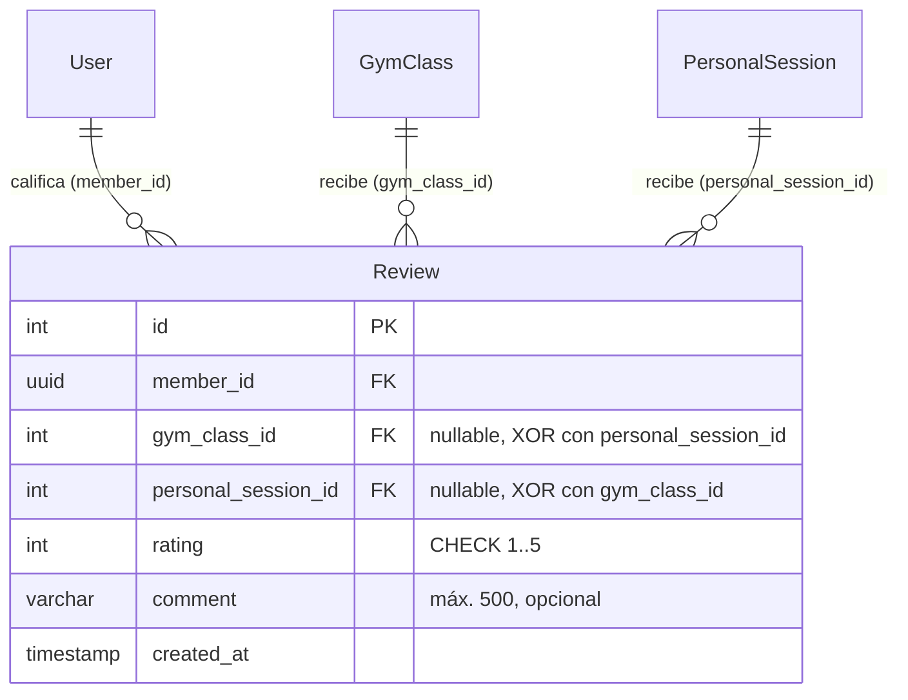

# Épica 8 · Reseñas (H22)

**H22 (SCRUM-37): Calificar una clase o sesión personal.** Subtareas: DB-22.1 (`SCRUM-143`), BE-22.1 (`SCRUM-144`), BE-22.2 (`SCRUM-145`).

## Endpoints

Todos los endpoints requieren JWT con rol **Miembro** (`403` para otro rol, `401` sin sesión).

| Método | Ruta | Subtarea | Descripción |
|---|---|---|---|
| `GET` | `/api/v1/reviews/pending` | BE-22.1 | Lista clases grupales y sesiones personales calificables dentro de los 7 días posteriores a su finalización. |
| `GET` | `/api/v1/reviews/me` | BE-22.1 | Lista las reseñas enviadas por el miembro autenticado. |
| `POST` | `/api/v1/reviews` | BE-22.2 | Registra una calificación de 1 a 5 estrellas y comentario opcional (hasta 500 caracteres). |

## Reglas de negocio

- **Ventana de 7 días (zona `America/El_Salvador`):** una clase o sesión puede calificarse desde que termina (`endsAt <= now`) y hasta el cierre (`23:59:59.999-06:00`) del séptimo día calendario posterior en la zona horaria del gimnasio.
- **Clases grupales (`CLASS`):** requiere clase `SCHEDULED` (no cancelada), reserva `CONFIRMED` del miembro y al menos un `CheckIn` del miembro en el mismo día del gimnasio antes o en el instante `endsAt`.
- **Sesiones personales (`PERSONAL_SESSION`):** requiere pertenecer al miembro del token, `status = COMPLETED` y `outcome = COMPLETED` (`NO_SHOW` responde `409` `"Solo puedes calificar sesiones que se realizaron."`).
- **Unicidad:** cada miembro puede calificar una sola vez cada clase o sesión (`409` `"Ya calificaste esta clase o sesión."`), garantizado también en PostgreSQL mediante restricciones únicas.
- **Verificación en servidor:** `POST /api/v1/reviews` vuelve a verificar todas las reglas al guardar dentro de una transacción.

## Diagrama entidad-relación



Reversión de la migración:

```bash
npx prisma db execute --file prisma/migrations/20261120191355_add_reviews/down.sql
```
